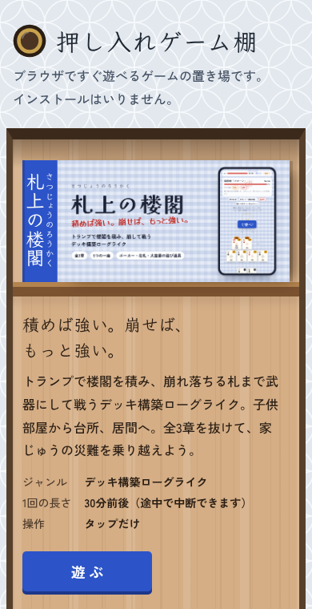

# 押し入れゲーム棚

ブラウザですぐ遊べるゲームの置き場です。トップページにゲームの箱が棚のように並び、ゲームはそれぞれ自分のフォルダに入っています。インストールは不要で、スマホでもパソコンでも遊べます。

## 遊ぶ

<!-- shelf:url -->
- トップページ: https://allexuc.github.io/osiire-gametana/
- 各ゲーム: `https://allexuc.github.io/osiire-gametana/<ゲームのフォルダ名>/` (例: [札上の楼閣](https://allexuc.github.io/osiire-gametana/satsujo/))
<!-- /shelf:url -->
- 手元で確かめる: リポジトリの一番上で `python3 -m http.server 8000` を実行し、`http://localhost:8000/` を開く

## ゲーム一覧

<!-- shelf:games -->
| ゲーム | ジャンル | 1回の長さ | 遊ぶ |
| --- | --- | --- | --- |
| **札上の楼閣**（さつじょうのろうかく） 積めば強い。崩せば、もっと強い。 | デッキ構築ローグライク | 30分前後（途中で中断できます） | [遊ぶ](https://allexuc.github.io/osiire-gametana/satsujo/) [説明](satsujo/README.md) |
<!-- /shelf:games -->

## フォルダ構成

| 場所 | 中身 |
| --- | --- |
| `index.html` | トップページ(`tools/shelf.py build` が作る。直接は編集しない) |
| `shelf.json` | 置き場の名前・紹介文・公開URLなどの設定 |
| `icon.svg`, `icon-192.png`, `apple-touch-icon.png`, `og.png` | トップページのアイコンと共有画像(`python3 tools/shelf.py images` で描き直せる) |
| `satsujo/` | 札上の楼閣。ゲームはすべて `<ID>/` の形で1本1フォルダ |
| `<ID>/game.json` | そのゲームの紹介文・色・版など。トップページの箱はここから作られる |
| `tools/shelf.py` | トップページやオフライン用ファイルを作り直す道具 |
| `tools/check_site.py` | 公開前の通し確認(トップページ→各ゲーム→戻る、エラー、オフライン、スクリーンショット) |
| `tools/templates/` | トップページ・共有画像・新しいゲームのひな形 |
| `_headers` | Cloudflare Pages 用のHTTPヘッダー(GitHub Pages では無視される) |
| `.nojekyll` | GitHub Pages でそのまま配信するための空ファイル |
| `CLAUDE.md` | Claude がこのリポジトリで作業するときに読む決まりごと |

## ゲームの足し方

道具は Python 3 だけで動きます(アイコンの描き出しと通し確認だけ Playwright を使います)。

1. 下書きを作る: `python3 tools/shelf.py new <ID> <タイトル>`
   - `<ID>/` に、決まりごとを済ませたひな形の `index.html`、`game.json`(status は `draft`)、仮のアイコンができます
   - 下書きはトップページに出ません。URL を知っていれば開けるので、試してもらうこともできます
2. `<ID>/index.html` にゲームを作る
3. `<ID>/game.json` に紹介文、ジャンル、遊ぶ時間、色を書く
4. `<ID>/icon.svg` と、1200×630 の `<ID>/og.png` を用意する。og.png は共有画像と、トップページの箱の表紙を兼ねます。`python3 tools/shelf.py images <ID>` でアイコンのPNGができます
5. 並べてよくなったら `game.json` の `status` を `public` にして `python3 tools/shelf.py build`
6. `python3 tools/shelf.py check` で決まりごとを、`python3 tools/check_site.py --shots <フォルダ>` で実際の動きを確かめる
7. コミットして push すると公開されます

### 決まりごと

全部のゲームが同じドメインに並ぶので、互いに邪魔しないように次を守ります。

- **フォルダ名 = ID**: 英小文字で始まる英小文字・数字・ハイフン。URL にもなります
- **保存キー**: localStorage のキーは `<ID>-` で始める(例: `satsujo-run-v3`)。ほかのゲームのデータを上書きしないため
- **トップページへの記録**: 遊んだときに `localStorage['shelf:<ID>']` へ `{"t": 時刻(ミリ秒), "note": "一言", "resume": 続きがあるか}` を書くと、箱の下に「きょう遊んだ」などが出ます(書かなくても動きます)
- **オフライン**: `sw.js` は `tools/shelf.py build` が作ります。キャッシュ名は `<ID>-v<版>` で、片付けるのは自分の古い版だけです。ゲームを直したら `game.json` の `version` を上げて build し直すと、遊ぶ人の手元も新しくなります
- **リンクは相対パス**: GitHub Pages ではリポジトリ名がURLに入るため、`/` から始まるパスは使わない。トップページへ戻るリンクは `../`
- **1200×630 の og.png**: 箱の表紙はこの比率で切り抜いて並べます

## 公開のしかた

ビルドは不要です。リポジトリをそのまま配信すれば動きます。公開URLが決まったら `shelf.json` の `base_url` に書いて `python3 tools/shelf.py build` を実行すると、SNSの共有画像が正しく出るようになります。

### GitHub Pages

1. このファイル一式を公開(Public)リポジトリの `main` ブランチ直下に置く
2. リポジトリの **Settings → Pages** を開く
3. **Build and deployment** の **Source** を **Deploy from a branch** にし、ブランチ `main`、フォルダ `/ (root)` を選んで **Save**
4. 数分で `https://<ユーザー名>.github.io/<リポジトリ名>/` に公開されます

リポジトリ名を `<ユーザー名>.github.io` にすると、`https://<ユーザー名>.github.io/` の直下がトップページになります。無料プランの GitHub Pages は公開リポジトリでのみ使えます。

### Cloudflare Pages

- GitHub と連携する場合: Cloudflare ダッシュボードの **Workers & Pages** で、このリポジトリを選んで新しい Pages プロジェクトを作る。ビルドコマンドは空、出力ディレクトリは `/`。以後は push するたびに自動で公開されます
- ファイルを直接上げる場合: **Workers & Pages → Create application → Drag and drop your files** で、このフォルダか zip をドラッグして **Deploy site**。直接アップロードで作ったプロジェクトは、あとから GitHub 連携に切り替えられません

## ライセンス

まだ決めていません。
