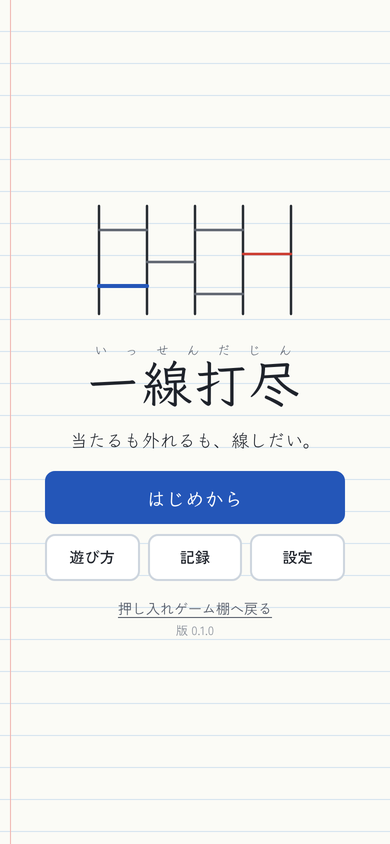
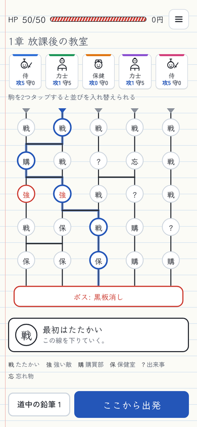
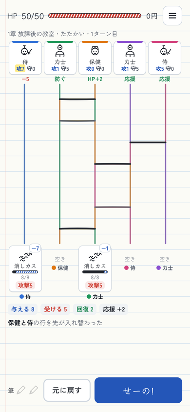
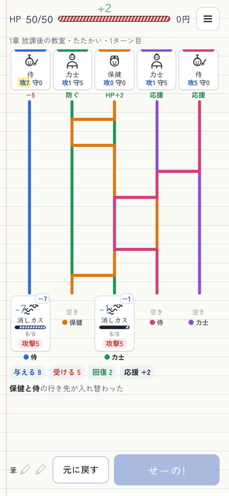

# 一線打尽(いっせんだじん)

**当たるも外れるも、線しだい。**

ノートに描いたあみだくじで、落書きの駒と文房具の付喪神(つくもがみ)が合戦する、ブラウザで遊べるローグライクです。インストール不要で、スマホでもパソコンでも遊べます。

<p>




</p>

## どんなゲームか

- 上に自分の駒が5つ、下に敵。「せーの!」で駒は線をたどって着いたマスの敵を攻撃し、敵の攻撃は同じ線を上ってその駒に来ます。あみだくじなので、当たる相手はいつも1対1です
- 毎ターン、横線を2本まで書き足すか消して、だれがだれとぶつかるかを決めます。横線1本で入れ替わるのは、その高さで隣り合う2つの駒の行き先です
- 敵は次の行動を予告します。攻撃のほかに、横槍(赤い線を引く)、消しゴム(線を消す)、黒板消し(全部消す)のように、盤をいじってきます
- 敵のいないマスに着いた駒は「応援」して、敵に当たった駒の攻を1ずつ上げます
- 道中の地図もあみだくじです。章のはじめに出発する縦線を選び、章に1回だけ横線を足して道を変えられます
- 全3章(放課後の教室・夕焼けの校庭・夜の校舎)、敵25種、駒17種、ペン6種、シール24種、出来事10種、学級(はじめの駒の組み合わせ)3つ
- ほかの遊びのルールを持ち込むシール: じゃんけん、鉛筆転がし、〇×ゲーム、あっち向いてホイ、だるまさんがころんだ、席替え、ドミノ倒し、消しゴム落とし、福笑い、かくれんぼ
- 画面はライトがノート、ダークが黒板です

## 保存データ

記録と遊びかけのランは、遊んでいるブラウザの中(localStorage の `amida-` で始まるキー)に保存されます。戦闘の途中でやめても、そのターンの始まりから続きを遊べます。端末やブラウザを変えると引き継がれません。一度開いたあとは、ホーム画面に追加してオフラインでも遊べます。

## ファイル

| ファイル | 内容 |
| --- | --- |
| `index.html` | ゲーム本体(HTML・CSS・JavaScript をこの1ファイルにまとめてある)。ルールの計算は `// ==ENGINE START==` から `// ==ENGINE END==` の間 |
| `game.json` | トップページに並べるための紹介文・色・版 |
| `sw.js`, `manifest.webmanifest` | オフライン用キャッシュとホーム画面用の設定(`tools/shelf.py build` が作る) |
| `icon*.png`, `icon.svg`, `apple-touch-icon.png` | ホーム画面に追加したときのアイコン |
| `og.png` | SNSで共有したときのプレビュー画像。トップページの箱の表紙も兼ねる |
| `tools/sim.js` | バランス確認用の自動プレイ(Node.js) |
| `docs/` | この README 用のスクリーンショット |

## バランスの確認

画面なしで自動プレイを回すシミュレーターがあります(Node.js 18 以降)。このフォルダで実行します。

```sh
node tools/sim.js index.html 300               # かしこいボットで300ラン(1年1組)
BOT=normal node tools/sim.js index.html 300    # 数か所だけ試して選ぶ、ふつうのボット
node tools/sim.js index.html 200 all           # 3つの学級を順に
STICKERS=all node tools/sim.js index.html 100  # シールを全部持たせる
PENS=hl,red,ruler node tools/sim.js index.html 100   # ペンを持たせて始める
LINEUP=sumo,sumo,nurikabe,yuki,daruma node tools/sim.js index.html 100  # 守りの駒だけ
NODRAW=1 node tools/sim.js index.html 50       # 線を一切引かない
FILL=1 node tools/sim.js index.html 50         # 盤を線で埋めてから始める(書けないとき)
TUNE="0:1.1,1.2" node tools/sim.js index.html 200  # 章ごとの敵のHP・攻撃の倍率を試す
```

エラーの有無、盤の決まり(同じ段で縦線を共有する横線がない、あみだくじが1対1)、戦闘が必ず終わることを毎回チェックし、クリア率・章ごとの到達・1戦闘のターン数・負けた相手などを表示します。

ゲームを直したら `game.json` の `version` と、`index.html` の中の `VERSION` を同じ番号に上げ、リポジトリの一番上で `python3 tools/shelf.py build` を実行してください。遊ぶ人の手元のキャッシュも新しい版に入れ替わります。
