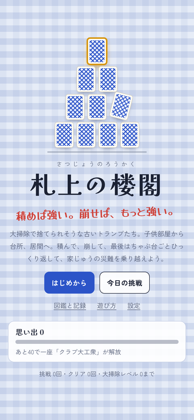
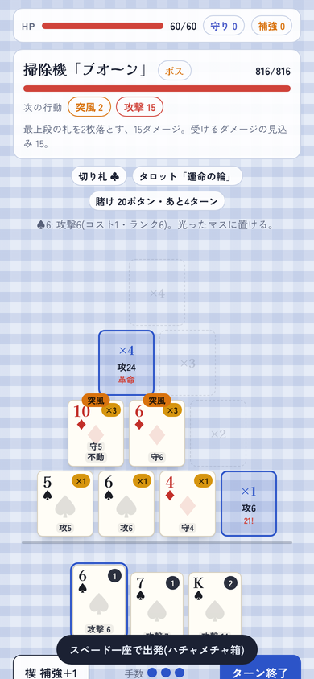
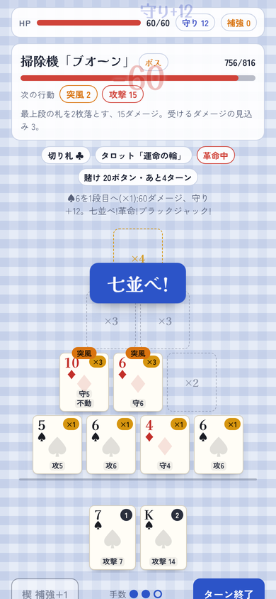
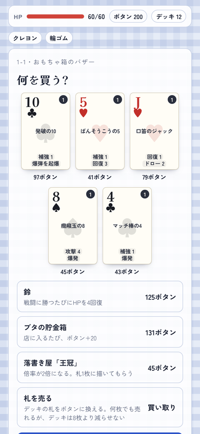

# 札上の楼閣(さつじょうのろうかく)

**積めば強い。崩せば、もっと強い。**

トランプで楼閣(トランプタワー)を積み、崩れ落ちる札まで武器にして戦う、ブラウザで遊べるデッキ構築ローグライクです。インストール不要で、スマホでもパソコンでも遊べます。

<p>




</p>

## どんなゲームか

- 手札の札を4段10マスの楼閣に積みます。上の段ほど倍率が高く、置いた瞬間に効果が出ます
- 敵は突風や揺れで塔を崩してきますが、落ちた札は敵に当たってダメージになります
- 10マスを埋めると「楼閣完成」。全部の札がもう一度発動し、塔ごと敵の上に崩れ落ちます
- 全3章(子供部屋・台所・居間)、敵21体、札56種、ガラクタ37種、出来事13種
- 5つの一座(スターターデッキ)、思い出による解放、大掃除レベル0〜10、今日の挑戦、図鑑
- 遊び道具: ポーカーの役、ブラックジャック、大富豪の革命、花札の役、タロット占いなど、ほかのカードゲームのルールを持ち込むガラクタが16種
- 「ハチャメチャ箱」をオンにすると、遊び道具を2つ持って出発できます

## 保存データ

記録と途中のランは、遊んでいるブラウザの中(localStorage の `satsujo-` で始まるキー)に保存されます。端末やブラウザを変えると引き継がれません。一度開いたあとは、ホーム画面に追加してオフラインでも遊べます。

## ファイル

| ファイル | 内容 |
| --- | --- |
| `index.html` | ゲーム本体(HTML・CSS・JavaScript をこの1ファイルにまとめてある) |
| `game.json` | トップページに並べるための紹介文・色・版 |
| `sw.js`, `manifest.webmanifest` | オフライン用キャッシュとホーム画面用の設定(`tools/shelf.py build` が作る) |
| `icon*.png`, `icon.svg`, `apple-touch-icon.png` | ホーム画面に追加したときのアイコン |
| `og.png` | SNSで共有したときのプレビュー画像。トップページの箱の表紙も兼ねる |
| `tools/sim.js` | バランス確認用の自動プレイ(Node.js) |
| `docs/` | この README 用のスクリーンショット |

## バランスの確認

画面なしで自動プレイを回すシミュレーターがあります(Node.js 18 以降)。このフォルダで実行します。

```sh
node tools/sim.js index.html 1000          # 大掃除レベル0で1000ラン
node tools/sim.js index.html 1000 5        # 大掃除レベル5
HACHA=1 node tools/sim.js index.html 1000  # ハチャメチャ箱
RELICS=tarot node tools/sim.js index.html 1000  # タロットカードを最初から持たせる
```

エラーの有無、札の枚数が増減しないこと、支えのない札が残らないことを毎回チェックし、クリア率・敵ごとの勝率・最大の一撃などを表示します。

ゲームを直したら `game.json` の `version` と、`index.html` の中の `VERSION` を同じ番号に上げ、リポジトリの一番上で `python3 tools/shelf.py build` を実行してください。遊ぶ人の手元のキャッシュも新しい版に入れ替わります。
